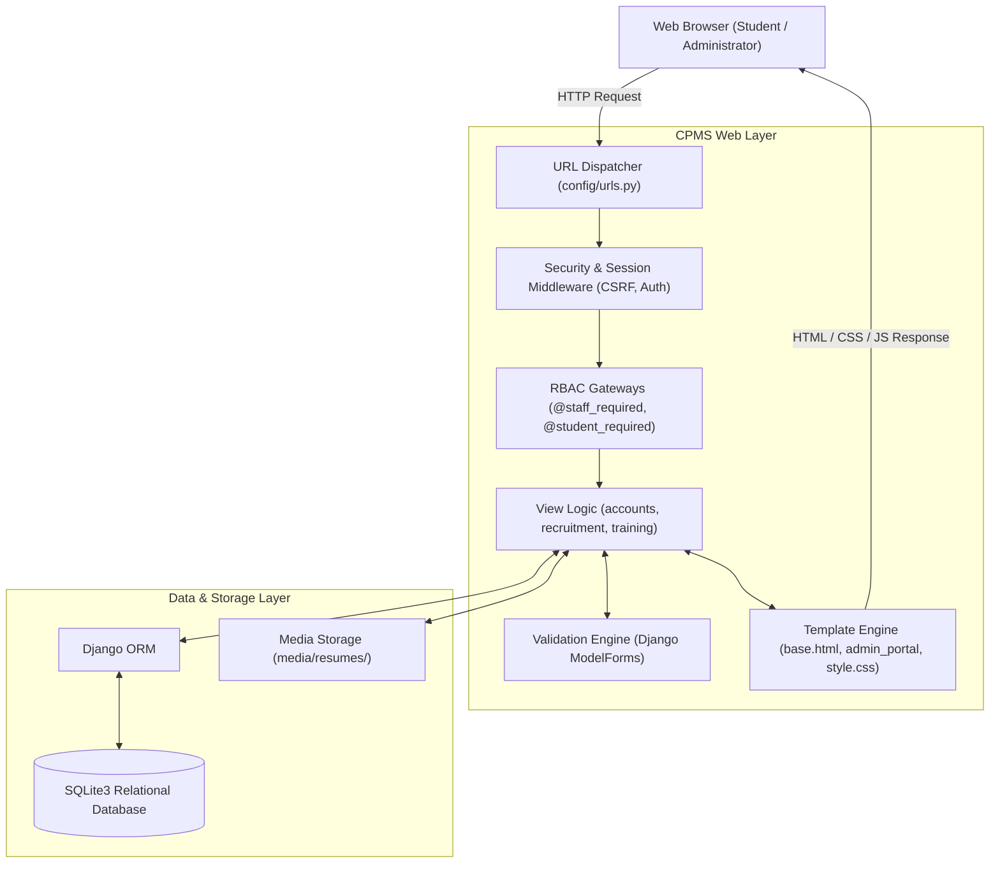

<p align="center">
  
</p>

<h1 align="center">CPMS &mdash; Campus Placement & Recruitment Portal</h1>

<p align="center">
  <strong>"Connecting Students, Recruiters, and Opportunities Through One Platform."</strong>
</p>

<p align="center">
  <a href="#about-the-project"></a>
  <a href="#about-the-project"></a>
  <a href="#about-the-project"></a>
  <a href="#about-the-project"></a>
  <a href="#about-the-project"></a>
  <a href="#about-the-project"></a>
  <a href="#about-the-project"></a>
  <a href="#about-the-project"></a>
</p>

---

## Table of Contents

- [About the Project](#about-the-project)
- [Key Features](#key-features)
  - [Student Portal](#student-portal)
  - [Placement Officer / Admin Portal](#placement-officer--admin-portal)
- [Application Views & Visual Reference](#application-views--visual-reference)
- [Technology Stack](#technology-stack)
- [System Architecture](#system-architecture)
- [Project Structure](#project-structure)
- [Installation & Local Setup](#installation--local-setup)
- [Default Login Credentials](#default-login-credentials-demo-environment)
- [Application Workflows](#application-workflows)
- [Security & RBAC Controls](#security--rbac-controls)
- [Automated Testing](#automated-testing)
- [Future Enhancements](#future-enhancements)
- [Author & Acknowledgments](#author--acknowledgments)

---

## About the Project

**CPMS (Campus Placement & Recruitment Portal)** is a modern, production-grade web application engineered in Python and Django to automate, streamline, and centralize the entire campus recruitment lifecycle for higher educational institutions.

### The Problem It Solves
Traditional college placement workflows often rely on disconnected spreadsheets, manual email chains, physical noticeboards, and verbal announcements. This decentralization leads to significant challenges:
- **Eligibility Mismatches:** Students frequently apply to drives for which their CGPA, active backlogs, or academic department disqualify them, placing immense manual screening burdens on the placement cell.
- **Opacity in Application Statuses:** Candidates remain unaware of whether their profiles were viewed, shortlisted, or advanced to interview rounds.
- **Data Privacy & GDPR/DPDP Concerns:** Student resumes and contact details are routinely forwarded through insecure email attachments.
- **Administrative Friction:** Placement officers must balance company communications, schedule interviews, record attendance, and compile placement statistics manually.

### The CPMS Solution
CPMS replaces disparate tools with a unified digital placement ecosystem:
- **Automated Eligibility Gating:** Strict backend validation automatically ensures only qualified students can submit applications based on real-time academic standing (CGPA thresholds, maximum allowed backlogs, and approved departments).
- **Dual Role-Based Interfaces:** Distinct, purpose-built frontend experiences for **Students** and **Placement Officers / Administrators**, ensuring routine administrative duties are performed entirely within a sleek CPMS dashboard rather than Django's default unbranded admin panel.
- **Live Lifecycle Tracking:** Full transparency across candidate submissions (`Applied` &rarr; `Shortlisted` &rarr; `Selected` &rarr; `Rejected` / `Withdrawn`) with instant real-time synchronization between administrator actions and student trackers.
- **Executive Analytics:** Live visual metrics and charts providing the placement office with real-time insight into corporate drive schedules, student selection rates, and department performance.

---

## Key Features

### Student Portal

| Feature | Description |
| :--- | :--- |
| **Role-Based Authentication** | Secure login and self-registration with terms, privacy policy, and DPDP Act consent tracking. |
| **Personal Student Dashboard** | View live counts of submitted applications, shortlists, job offers, upcoming interview schedules, and open eligible drives. |
| **Placement Drives Catalogue** | Browse corporate recruitment drives with real-time category filtering (`IT`, `Core Engineering`, `Banking & Finance`). |
| **Automated Eligibility Checks** | Live evaluation comparing student CGPA, backlogs, and department against drive cutoffs with clear visual status banners. |
| **Seamless Application Submission** | One-click application using an existing profile resume or uploading a drive-specific resume (`PDF`, `DOC`, `DOCX` up to 2 MB). |
| **Real-Time Application Tracker** | Track application progress through all stages (`Applied`, `Shortlisted`, `Selected`, `Rejected`, `Withdrawn`) with interview details. |
| **Application Withdrawal** | Safe self-service withdrawal allowed while applications are in early review stages (`Applied` or `Shortlisted`). |
| **Academic & Profile Management** | Verified academic record display (USN, Department, Batch, CGPA, Backlogs) with phone and master resume upload controls. |
| **Skill-Building Training Catalogue**| Browse college-organized technical training programs, bootcamps, and workshops. |

### Placement Officer / Admin Portal

| Feature | Description |
| :--- | :--- |
| **Executive Admin Dashboard** | 8 database-backed metric cards, selection ratio gauges, monthly application trend bars, and recent activity streams. |
| **Student Directory Management** | Paginated student table with multi-criteria search (Name, USN, Email) and filters by Department, Batch, and Status. |
| **Student Record Maintenance** | View full academic dossiers, edit student contact/academic details without exposing passwords, and toggle account activation. |
| **Authorized Resume Access** | Secure streaming of uploaded student resumes via `FileResponse` with strict authorization checks. |
| **Partner Company Directory** | Comprehensive database of recruiting partners with recruiter contacts, website links, and associated drive statistics. |
| **Placement Drive Lifecycle** | Full CRUD for drives: configure company, package (LPA), vacancies, cutoff CGPA, backlogs, department access, and milestones. |
| **Quick Drive Status Actions** | One-click drive workflow transitions (`DRAFT` &rarr; `OPEN` &rarr; `CLOSED` &rarr; `COMPLETED`). |
| **Central Application Pipeline** | Multi-faceted filtering of candidate applications by Company, Drive, Department, and Status with quick inline status updates. |
| **Interview & Offer Tracking** | Record and monitor multi-stage assessment rounds (Aptitude, Technical, HR, GD) and official placement offers. |
| **Training Program Management** | Schedule workshops, assign trainers, set batch capacities, define delivery modes (`Online`, `Offline`, `Hybrid`), and view enrolled rosters. |
| **Foreign-Key Protected Deletion** | Safe deletion safeguards that prevent deleting companies, drives, or training programs that possess linked active records. |

---

## Application Views & Visual Reference

The table below outlines the core application views implemented in the portal:

| Application View | User Role | Core Highlights & Features | Preview Details |
| :--- | :--- | :--- | :--- |
| **Admin Dashboard** | Administrator | Live placement KPIs, real-time gauges, monthly trends, and recent registration streams | Executive analytics, selection ratio, KPI cards |
| **Student Dashboard** | Student | Active applications overview, upcoming interview schedules, and eligible open drives | Personalized candidate command center |
| **Placement Drives Directory** | Both | Filterable drives catalogue by sector (`IT`, `Core`, `Banking`) with cutoff criteria | Corporate drives roster with eligibility cutoffs |
| **Drive Details & Application** | Student | Comprehensive role requirements, cutoff thresholds, and resume upload modal | Job description, CTC, and application modal |
| **My Applications Tracker** | Student | Real-time recruitment tracker with status badges (`Applied`, `Shortlisted`, `Selected`) | Live candidate progression pipeline |
| **Student Profile & Academic Record** | Student | Official verified academic records, backlog counts, and master resume upload | Academic metrics, contact, and resume status |
| **Student Records Management** | Administrator | Searchable student directory with multi-field search (Name, USN, Email) and batch filters | Student dossiers, edit form without passwords |
| **Partner Company Directory** | Administrator | Corporate partners roster with recruiter contacts, website links, and drive counts | Corporate directory & placement drive metrics |
| **Placement Drive Management** | Administrator | Drive authoring, package LPA, cutoff CGPA, backlog thresholds, and status pills | Drive configurations & applicant rosters |
| **Application Review Pipeline** | Administrator | Candidate review table with inline status update dropdowns and secure resume streaming | Inline candidate status transitions |
| **Training Programs Management** | Both / Admin | Career development workshop catalogue, delivery modes, and batch capacities | Training catalogue & enrolled student roster |

---

## Technology Stack

| Category | Technology | Usage in CPMS |
| :--- | :--- | :--- |
| **Backend Framework** | **Python 3.13** &amp; **Django 6.1** | Core server-side framework, MVC/MVT architecture, ORM, URL routing, and middleware. |
| **Frontend UI** | **HTML5** &amp; **CSS3** | Semantic, accessible templates with custom Navy &amp; Teal design system, responsive grids, and SVG charts. |
| **Client-Side Scripting**| **Vanilla JavaScript** | Interactive UI components: status auto-submits, password visibility toggling, and confirmation modals. |
| **Database** | **SQLite3** | Relational database engine with relational foreign keys, cascade protections, and unique constraints. |
| **Authentication** | **Django Auth &amp; RBAC** | Custom session authentication, Group permissions, password hashing (PBKDF2), and `@staff_required` decorators. |
| **Media &amp; File Storage**| **Django Storage** | File streaming via `FileResponse` for candidate resume management (`PDF`, `DOC`, `DOCX`). |
| **Version Control** | **Git &amp; GitHub** | Distributed source code management and collaborative version tracking. |

---

## System Architecture

CPMS is built on Django's Model-View-Template (MVT) pattern, strictly separating presentation, business logic, and database persistence:



### Architectural Highlights
- **Role-Based Routing Isolation:** Students and placement officers use dedicated endpoints. Unprivileged users attempting to probe `/admin-dashboard/` URLs are intercepted by `@staff_required` before any view logic executes.
- **Atomic Operations:** Multi-table mutations (e.g., student profile updates or drive application state changes) execute within `@transaction.atomic` blocks to maintain complete database integrity.
- **Optimized ORM Queries:** Views utilize `.select_related()` and `.prefetch_related()` alongside query annotations (`Count()`, `Avg()`) to prevent $N+1$ query overheads.

---

## Project Structure

```text
CPMS/
├── accounts/                     # Authentication, User Profiles & Admin Portal Views
│   ├── management/commands/      # Custom CLI tools (create_admin, seed_data, setup_roles)
│   ├── admin_views.py            # Centralized Frontend Admin Portal view controllers
│   ├── context_processors.py     # Global legal and institution metadata context
│   ├── decorators.py             # Security decorators (@staff_required, @student_required)
│   ├── forms.py                  # Student login, registration, and admin edit forms
│   ├── models.py                 # Department, StudentProfile models
│   ├── roles.py                  # Role-based Groups and Permission definitions
│   ├── tests.py                  # Test suites for auth, admin dashboard & management
│   ├── urls.py                   # Student authentication and dashboard routes
│   └── views.py                  # Home, login, student dashboard & profile views
├── config/                       # Root Django Project Configuration
│   ├── asgi.py                   # ASGI entry point
│   ├── settings.py               # Application settings, middleware & database configs
│   ├── urls.py                   # Top-level URL routing table
│   └── wsgi.py                   # WSGI production entry point
├── media/                        # User-Uploaded Media Assets
│   └── resumes/                  # Securely stored student resumes
├── recruitment/                  # Placement Drives & Applications Module
│   ├── forms.py                  # ApplicationForm, CompanyForm, PlacementDriveForm
│   ├── models.py                 # Company, PlacementDrive, Application, InterviewRound, PlacementOffer
│   ├── tests.py                  # Placement drive CRUD, eligibility & status workflow tests
│   ├── urls.py                   # Public & student drive routes
│   └── views.py                  # Student drive browsing, applying, and withdrawal views
├── static/                       # Static Assets
│   ├── css/
│   │   ├── public.css            # Public landing and legal pages styling
│   │   └── style.css             # Main CPMS application design system (Navy & Teal)
│   └── images/                   # CPMS branding logos, emblems, and favicons
├── templates/                    # HTML Presentation Templates
│   ├── 403.html                  # Custom Access Denied error page
│   ├── auth_base.html            # Clean layout for student & staff login pages
│   ├── base.html                 # Core application shell with dynamic role-based sidebar
│   ├── dashboard.html            # Executive Admin Dashboard template with charts
│   ├── public_base.html          # Public landing layout
│   ├── accounts/                 # Student login, register, profile, and student dashboard
│   ├── admin_portal/             # Frontend Administrator Management Templates
│   │   ├── applications/         # Application roster & detailed workflow tracker
│   │   ├── companies/            # Company directory, profile & add/edit forms
│   │   ├── drives/               # Placement drives catalogue, specification & forms
│   │   ├── students/             # Student records directory, detail & edit forms
│   │   └── training/             # Training catalogue, detail & add/edit forms
│   ├── legal/                    # Privacy policy, Terms, and DPDP notice templates
│   ├── recruitment/              # Student-facing drives, application & apply templates
│   └── training/                 # Student-facing training programs catalogue
├── training/                     # Career Development & Workshops Module
│   ├── forms.py                  # TrainingProgramForm with date & capacity validation
│   ├── models.py                 # TrainingProgram, TrainingEnrollment, TrainingAttendance
│   ├── tests.py                  # Training management CRUD & enrollment protection tests
│   ├── urls.py                   # Student training URLs
│   └── views.py                  # Student training catalogue views
├── cpms_logo.png                 # Main project logo
├── db.sqlite3                    # Local development database
├── manage.py                     # Django management script
└── requirements.txt              # Production and development dependencies
```

---

## Installation & Local Setup

Follow these step-by-step instructions to set up and run the CPMS project on your local machine (Windows PowerShell syntax provided).

### 1. Prerequisites
- **Python 3.10+** (Python 3.13 recommended)
- **Git**

### 2. Clone the Repository
```powershell
git clone https://github.com/Samcode-16/Campus-Placement-Management-System.git
cd Campus-Placement-Management-System
```

### 3. Create and Activate a Virtual Environment
```powershell
python -m venv venv
.\venv\Scripts\activate
```

### 4. Install Dependencies
```powershell
pip install -r requirements.txt
```

### 5. Apply Database Migrations
```powershell
python manage.py migrate
```

### 6. Initialize Roles and Seed Demo Data *(Recommended)*
CPMS includes custom management commands to seed realistic sample departments, students, corporate partners, placement drives, and applications:
```powershell
# Populate sample departments, companies, drives, and student records
python manage.py seed_data

# Set up RBAC groups and permissions
python manage.py setup_roles
```

### 7. Create an Administrator Account
You can either use the pre-seeded officer credentials or create your own custom administrator account:
```powershell
# Create a custom administrator with full staff and superuser privileges
python manage.py create_admin --username admin --email admin@college.edu --password AdminPassword!123
```

### 8. Run the Development Server
```powershell
python manage.py runserver
```
Once started, open your web browser and navigate to:
- **Public Portal:** `http://127.0.0.1:8000/`
- **Student Login:** `http://127.0.0.1:8000/accounts/login/`
- **Officer Login:** `http://127.0.0.1:8000/accounts/staff-login/`
- **Frontend Admin Dashboard:** `http://127.0.0.1:8000/admin-dashboard/`

---

## Default Login Credentials (Demo Environment)

When the project is populated using `python manage.py seed_data`, the following test accounts are readily available:

| Role | Username | Password | Default Destination |
| :--- | :--- | :--- | :--- |
| **Placement Officer / Admin** | `officer` | `Cpms@Demo2026` | `/admin-dashboard/` |
| **Student (BCA - Class of 2027)** | `anjali` | `Cpms@Demo2026` | `/accounts/dashboard/` |
| **Student (BSCCS - Class of 2027)** | `meghana` | `Cpms@Demo2026` | `/accounts/dashboard/` |
| **Student (MCA - Class of 2026)** | `nikhil` | `Cpms@Demo2026` | `/accounts/dashboard/` |

---

## Application Workflows

### Student Recruitment Journey
1. **Login or Registration:** The student logs in via the Student Login portal or registers with their academic USN and department.
2. **Profile Completion:** Navigates to **My Profile** to verify CGPA, backlog counts, and upload their latest PDF/Word resume.
3. **Exploring Opportunities:** Browses **Placement Drives**; the system dynamically inspects cutoffs against student credentials and renders eligible tags.
4. **Submitting an Application:** The student clicks **Apply**, optionally uploads a customized drive resume, and confirms submission.
5. **Tracking Progress:** Under **My Applications**, the student monitors their live status badge (`Applied` &rarr; `Shortlisted` &rarr; `Selected`), checks interview round timings, and reviews extended job offers.

### Placement Officer Operations Workflow
1. **Officer Login:** The placement coordinator logs in via the dedicated Staff Login and lands directly on the **Frontend Admin Dashboard**.
2. **Dashboard Review:** Analyzes live KPI cards, sector breakdowns, and recent student submissions.
3. **Drive Scheduling:** Navigates to **Placement Drives** &rarr; **+ Create Placement Drive** to define role packages, minimum CGPA, eligible departments, and deadlines.
4. **Candidate Review:** Navigates to **Applications** or a specific drive roster; the officer reviews candidate credentials, downloads submitted resumes, and updates statuses (`Shortlisted`, `Selected`, etc.).
5. **Student Updates:** The student's dashboard and tracking views reflect status changes immediately without page reload conflicts.
6. **Training Logistics:** Creates and coordinates skill workshops under **Training Programs**, tracking attendance percentages and assessment scores.

---

## Security & RBAC Controls

CPMS implements security best practices to protect sensitive academic and corporate records:
- **Frontend Admin Insulation:** Placement administrators are never routed to Django's unbranded `/admin/` portal for daily operations.
- **Strict Role-Based Access Control (RBAC):** Backend views enforce `@staff_required` or `@student_required`. Unauthorized cross-portal access attempts trigger automatic 403 blocks or redirection with error notifications.
- **Credential Protection:** Student password hashes are never included or rendered in administrative edit forms.
- **Resume Access Safeguards:** Resume downloads are streamed via an authenticated `FileResponse` view; raw storage paths are shielded from unauthenticated access.
- **CSRF Token Verification:** Every state-altering action (create, update, delete, status toggle) is protected with Django's CSRF token and requires HTTP POST.
- **Referential Integrity Enforcement:** Placement drives, companies, and training programs with linked dependencies cannot be deleted accidentally.

---

## Automated Testing

CPMS maintains an automated test suite comprising **87 unit and integration tests** covering all 5 architectural phases:

```powershell
# Run the entire test suite
python manage.py test
```

```text
Creating test database for alias 'default'...
.......................................................................................
----------------------------------------------------------------------
Ran 87 tests in 204.419s

OK
Destroying test database for alias 'default'...
Found 87 test(s).
System check identified no issues (0 silenced).
```

### Test Coverage Highlights
- **Authentication & RBAC:** Verification of login role separation, unauthorized admin route access prevention, superuser assignment, and safe logout.
- **Student Profile & Privacy:** Resume validation (type and size restrictions), phone number formatting, and DPDP consent tracking.
- **Student & Company Management:** Full CRUD verification, multi-parameter search (USN, Name, Email), pagination integrity, and foreign-key deletion protection.
- **Placement Drive & Application Logic:** Cutoff eligibility evaluations, duplicate application prevention, application deadline enforcement, and status workflow synchronization.
- **Training Program Management:** Multi-mode filtering, capacity validation, schedule date sanity checks, and enrollment protection.

---

## Future Enhancements

While CPMS provides a feature-complete campus recruitment platform, the following features are planned for future iterations:

- [ ] **Automated Email & SMS Notifications:** Integration with SMTP/SendGrid and SMS gateways to dispatch instant interview invitations and offer alerts.
- [ ] **AI Resume Matching:** Automatic extraction and NLP scoring of candidate resume skills against job descriptions.
- [ ] **Corporate Recruiter Portal:** Dedicated third-party portal allowing verified recruiters to post drives and review shortlisted candidates directly.
- [ ] **Calendar Synchronization:** Exporting interview round dates and drive deadlines to Google Calendar and Microsoft Outlook via `.ics` feeds.
- [ ] **Exportable Reports:** One-click generation of NAAC/NIRF accreditation-ready placement audit reports in Excel and PDF formats.

---

## Author & Acknowledgments

- **Developer:** [Samcode-16](https://github.com/Samcode-16)
- **Institution:** Department of Computer Applications &mdash; Campus Placement Management System (CPMS)
- **Framework:** [Django Software Foundation](https://www.djangoproject.com/)

---

<p align="center">
  <sub>Developed for academic demonstration and campus placement automation.</sub>
</p>
