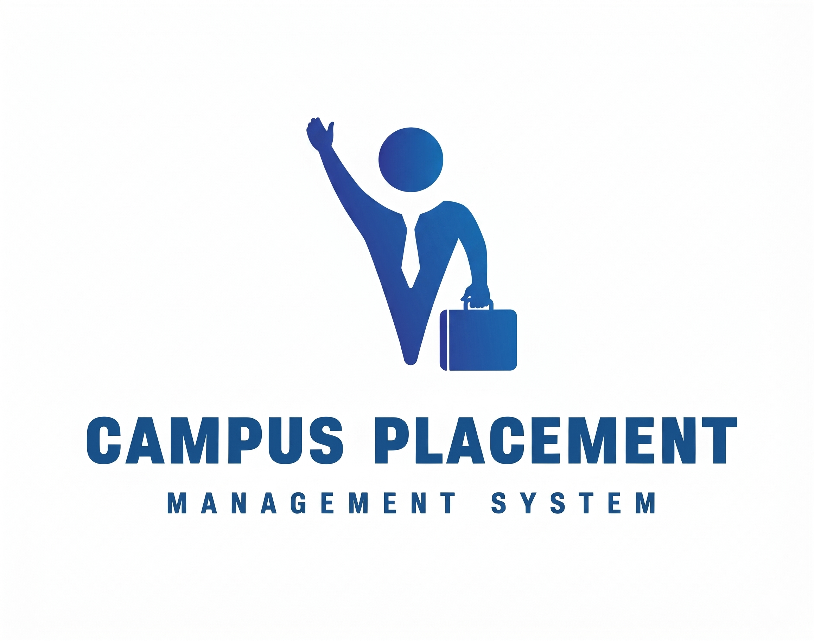
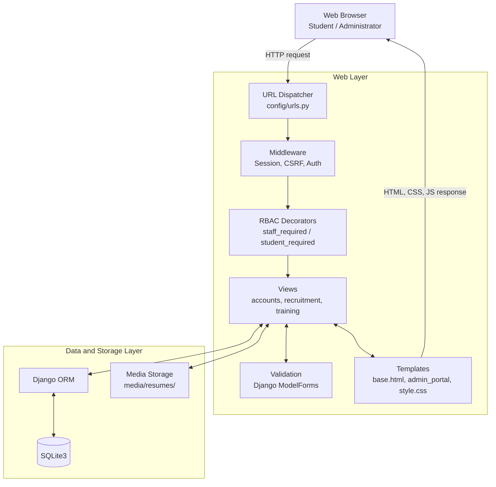
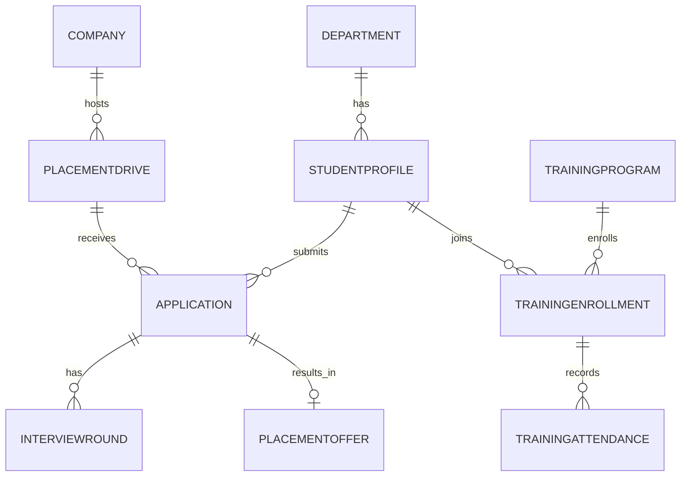
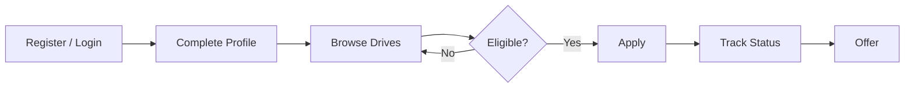

<p align="center">
  
</p>

<h1 align="center">CPMS: Campus Placement & Recruitment Portal</h1>

<p align="center">
  <strong>Connecting students, recruiters, and opportunities through one platform.</strong>
</p>

<p align="center">
  
  
  
  
  
  
  
</p>

<p align="center">
  <a href="#quick-start">Quick Start</a> ·
  <a href="#key-features">Features</a> ·
  <a href="#screenshots">Screenshots</a> ·
  <a href="#system-architecture">Architecture</a> ·
  <a href="#automated-testing">Tests</a>
</p>

---

## Table of Contents

- [Table of Contents](#table-of-contents)
- [About the Project](#about-the-project)
  - [The problem](#the-problem)
  - [The solution](#the-solution)
- [Quick Start](#quick-start)
- [Key Features](#key-features)
  - [Student Portal](#student-portal)
  - [Placement Officer / Admin Portal](#placement-officer--admin-portal)
- [Screenshots](#screenshots)
- [Technology Stack](#technology-stack)
- [System Architecture](#system-architecture)
  - [Architectural highlights](#architectural-highlights)
- [Data Model](#data-model)
- [Project Structure](#project-structure)
- [Installation \& Local Setup](#installation--local-setup)
  - [Prerequisites](#prerequisites)
  - [Steps](#steps)
  - [URLs](#urls)
- [Demo Credentials](#demo-credentials)
- [Application Workflows](#application-workflows)
  - [Student journey](#student-journey)
  - [Placement officer workflow](#placement-officer-workflow)
- [Security \& RBAC](#security--rbac)
  - [Before deploying to production](#before-deploying-to-production)
- [Automated Testing](#automated-testing)
  - [Coverage highlights](#coverage-highlights)
- [Roadmap](#roadmap)
- [Contributing](#contributing)
- [Author \& Acknowledgments](#author--acknowledgments)

---

## About the Project

**CPMS** is a web application built with Python and Django that centralizes the campus recruitment lifecycle for colleges: drives, eligibility, applications, interviews, offers, and training.

### The problem

Placement cells often run on spreadsheets, email chains, noticeboards, and word of mouth. That causes:

- **Eligibility mismatches:** students apply to drives their CGPA, backlogs, or department disqualify them from, and the placement cell screens them by hand.
- **Opaque statuses:** candidates don't know whether their profile was seen, shortlisted, or moved to interviews.
- **Privacy risks (DPDP Act):** resumes and contact details travel as email attachments.
- **Administrative overhead:** officers juggle company communication, scheduling, and statistics manually.

### The solution

- **Automated eligibility gating:** the backend checks CGPA, maximum backlogs, and allowed departments before any application is accepted.
- **Two purpose-built interfaces:** one for students, one for placement officers. Officers never need Django's default `/admin/` panel for daily work.
- **Live lifecycle tracking:** `Applied` → `Shortlisted` → `Selected` / `Rejected` / `Withdrawn`, with officer actions reflected instantly in the student's tracker.
- **Placement analytics:** KPI cards, selection ratios, and monthly application trends on the officer dashboard.

---

## Quick Start

```powershell
git clone https://github.com/Samcode-16/Campus-Placement-Management-System.git
cd Campus-Placement-Management-System
python -m venv venv
.\venv\Scripts\activate
pip install -r requirements.txt
python manage.py migrate
python manage.py seed_data
python manage.py setup_roles
python manage.py runserver
```

Open <http://127.0.0.1:8000/> and sign in with the [demo credentials](#demo-credentials). macOS/Linux users: replace the activate line with `source venv/bin/activate`.

---

## Key Features

### Student Portal

| Feature | Description |
| :--- | :--- |
| **Authentication** | Secure login and self-registration with terms, privacy policy, and DPDP Act consent tracking. |
| **Dashboard** | Live counts of applications, shortlists, offers, upcoming interviews, and open eligible drives. |
| **Drives catalogue** | Browse drives with category filters (`IT`, `Core Engineering`, `Banking & Finance`). |
| **Eligibility checks** | Student CGPA, backlogs, and department are compared against drive cutoffs, with clear status banners. |
| **One-click apply** | Use the profile resume or upload a drive-specific one (`PDF`, `DOC`, `DOCX`, up to 2 MB). |
| **Application tracker** | Follow every stage, including interview details and offers. |
| **Withdrawal** | Self-service withdrawal while an application is `Applied` or `Shortlisted`. |
| **Profile** | Verified academic record (USN, Department, Batch, CGPA, Backlogs), phone, and master resume. |
| **Training catalogue** | Browse college-organized workshops, bootcamps, and training programs. |

### Placement Officer / Admin Portal

| Feature | Description |
| :--- | :--- |
| **Executive dashboard** | 8 metric cards, selection-ratio gauges, monthly trend bars, and recent activity. |
| **Student directory** | Paginated table; search by name, USN, or email; filter by department, batch, and status. |
| **Student records** | View academic dossiers, edit contact/academic details (never passwords), activate or deactivate accounts. |
| **Resume access** | Resumes stream through an authorized `FileResponse` view. |
| **Company directory** | Partner companies with recruiter contacts, websites, and drive statistics. |
| **Drive management** | Full CRUD: company, package (LPA), vacancies, cutoff CGPA, backlogs, departments, milestones. |
| **Drive status actions** | One-click transitions: `DRAFT` → `OPEN` → `CLOSED` → `COMPLETED`. |
| **Application pipeline** | Filter by company, drive, department, and status; update status inline. |
| **Interviews & offers** | Track rounds (Aptitude, Technical, HR, GD) and placement offers. |
| **Training management** | Schedule programs, assign trainers, set capacity and mode (`Online`, `Offline`, `Hybrid`), view rosters. |
| **Deletion protection** | Companies, drives, and training programs with linked records can't be deleted. |

---

## Screenshots

> Add your images to `docs/screenshots/` and they will render below.

| Admin Dashboard | Student Dashboard |
| :---: | :---: |
|  |  |
| **Drive Details & Apply** | **My Applications** |
|  |  |
| **Application Pipeline (Admin)** | **Training Programs** |
|  |  |

<details>
<summary><strong>All application views</strong></summary>

| View | Role | Highlights |
| :--- | :--- | :--- |
| Admin Dashboard | Admin | Placement KPIs, gauges, monthly trends, recent registrations |
| Student Dashboard | Student | Active applications, upcoming interviews, eligible open drives |
| Placement Drives | Both | Filterable catalogue with cutoff criteria |
| Drive Details & Apply | Student | Role requirements, cutoffs, resume upload modal |
| My Applications | Student | Live status badges and interview details |
| Student Profile | Student | Academic record, backlog count, resume upload |
| Student Records | Admin | Searchable directory, edit form without passwords |
| Company Directory | Admin | Recruiter contacts, websites, drive counts |
| Drive Management | Admin | Authoring, LPA, cutoffs, status pills, applicant rosters |
| Application Pipeline | Admin | Inline status updates, secure resume streaming |
| Training Programs | Both | Workshop catalogue, delivery modes, capacities, rosters |

</details>

---

## Technology Stack

| Category | Technology | Usage |
| :--- | :--- | :--- |
| **Backend** | Python 3.13, Django 6.1 | MVT architecture, ORM, URL routing, middleware |
| **Frontend** | HTML5, CSS3 | Accessible templates, Navy & Teal design system, responsive grids, SVG charts |
| **Scripting** | Vanilla JavaScript | Status auto-submit, password toggle, confirmation modals |
| **Database** | SQLite3 | Foreign keys, cascade protection, unique constraints |
| **Auth** | Django Auth, Groups | Session auth, PBKDF2 hashing, `@staff_required` / `@student_required` |
| **Files** | Django Storage | Resume upload and streaming (`PDF`, `DOC`, `DOCX`) |
| **VCS** | Git & GitHub | Source control |

---

## System Architecture

CPMS follows Django's Model-View-Template (MVT) pattern.



<details>
<summary>Diagram not rendering? Text version</summary>

```text
Browser -> URL Dispatcher -> Middleware (Session/CSRF/Auth) -> RBAC Decorators -> Views
Views <-> Forms (ModelForms validation)
Views <-> Templates -> HTML/CSS/JS back to the browser
Views <-> Django ORM <-> SQLite3
Views <-> Media storage (media/resumes/)
```

</details>

### Architectural highlights

- **Role-based routing isolation:** non-staff users probing `/admin-dashboard/` are stopped by `@staff_required` before any view logic runs.
- **Atomic operations:** multi-table changes (profile updates, application state changes) run inside `@transaction.atomic`.
- **Optimized queries:** `select_related()`, `prefetch_related()`, and annotations (`Count()`, `Avg()`) avoid N+1 query problems.

---

## Data Model

Simplified entity relationships across the apps:



> Adjust cardinalities to match your actual `models.py` if they differ.

---

## Project Structure

```text
CPMS/
├── accounts/                  # Auth, profiles, admin portal views
│   ├── management/commands/   # create_admin, seed_data, setup_roles
│   ├── admin_views.py         # Frontend admin portal controllers
│   ├── context_processors.py  # Legal and institution metadata
│   ├── decorators.py          # @staff_required, @student_required
│   ├── forms.py               # Login, registration, admin edit forms
│   ├── models.py              # Department, StudentProfile
│   ├── roles.py               # Groups and permissions
│   ├── tests.py
│   ├── urls.py
│   └── views.py               # Home, login, student dashboard, profile
├── config/                    # Project configuration
│   ├── asgi.py
│   ├── settings.py
│   ├── urls.py
│   └── wsgi.py
├── media/resumes/             # Uploaded resumes
├── recruitment/               # Drives and applications
│   ├── forms.py               # ApplicationForm, CompanyForm, PlacementDriveForm
│   ├── models.py              # Company, PlacementDrive, Application, InterviewRound, PlacementOffer
│   ├── tests.py
│   ├── urls.py
│   └── views.py
├── static/
│   ├── css/                   # public.css, style.css
│   └── images/                # Logos, emblems, favicons
├── templates/
│   ├── admin_portal/          # applications, companies, drives, students, training
│   ├── accounts/              # Student login, register, profile, dashboard
│   ├── legal/                 # Privacy, Terms, DPDP notice
│   ├── recruitment/           # Student-facing drives and apply pages
│   ├── training/              # Student-facing training catalogue
│   ├── 403.html, auth_base.html, base.html, dashboard.html, public_base.html
├── training/                  # Workshops and career development
│   ├── forms.py               # TrainingProgramForm
│   ├── models.py              # TrainingProgram, TrainingEnrollment, TrainingAttendance
│   ├── tests.py
│   ├── urls.py
│   └── views.py
├── cpms_logo.png
├── db.sqlite3                 # Local development database
├── manage.py
└── requirements.txt
```

---

## Installation & Local Setup

### Prerequisites

- Python 3.10+ (3.13 recommended)
- Git

### Steps

```powershell
# 1. Clone
git clone https://github.com/Samcode-16/Campus-Placement-Management-System.git
cd Campus-Placement-Management-System

# 2. Virtual environment
python -m venv venv
.\venv\Scripts\activate

# 3. Dependencies
pip install -r requirements.txt

# 4. Database
python manage.py migrate

# 5. Roles and demo data (recommended)
python manage.py setup_roles
python manage.py seed_data

# 6. Optional: custom administrator
python manage.py create_admin --username admin --email admin@college.edu --password <choose-a-strong-password>

# 7. Run
python manage.py runserver
```

### URLs

| Page | URL |
| :--- | :--- |
| Public portal | `http://127.0.0.1:8000/` |
| Student login | `http://127.0.0.1:8000/accounts/login/` |
| Officer login | `http://127.0.0.1:8000/accounts/staff-login/` |
| Admin dashboard | `http://127.0.0.1:8000/admin-dashboard/` |

---

## Demo Credentials

Created by `python manage.py seed_data`. **For local demos only. Never deploy with these accounts.**

| Role | Username | Password | Lands on |
| :--- | :--- | :--- | :--- |
| Placement Officer / Admin | `officer` | `Cpms@Demo2026` | `/admin-dashboard/` |
| Student (BCA, 2027) | `anjali` | `Cpms@Demo2026` | `/accounts/dashboard/` |
| Student (BSCCS, 2027) | `meghana` | `Cpms@Demo2026` | `/accounts/dashboard/` |
| Student (MCA, 2026) | `nikhil` | `Cpms@Demo2026` | `/accounts/dashboard/` |

---

## Application Workflows

### Student journey



1. **Login or register** with USN and department.
2. **Complete profile:** verify CGPA and backlogs, upload the latest resume.
3. **Explore drives:** eligibility is evaluated live against each drive's cutoffs.
4. **Apply:** optionally attach a drive-specific resume.
5. **Track:** follow `Applied` → `Shortlisted` → `Selected`, interview rounds, and offers.

### Placement officer workflow

1. **Staff login** lands on the admin dashboard.
2. **Review** KPIs, sector breakdowns, and recent submissions.
3. **Create drives:** package, minimum CGPA, eligible departments, deadlines.
4. **Review candidates:** open resumes and update statuses.
5. **Students see changes immediately** in their tracker.
6. **Run training programs:** schedule workshops, track attendance and scores.

---

## Security & RBAC

- **Admin insulation:** officers never use Django's unbranded `/admin/` for daily operations.
- **Strict RBAC:** `@staff_required` / `@student_required` return 403 or redirect on cross-portal access.
- **Credential protection:** password hashes never appear in admin edit forms.
- **Resume safeguards:** downloads go through an authenticated `FileResponse`; raw storage paths are not exposed.
- **CSRF protection:** every state-changing action requires POST with a CSRF token.
- **Referential integrity:** records with linked dependencies can't be deleted.

### Before deploying to production

- Set `DEBUG = False` and a strong, secret `SECRET_KEY` loaded from environment variables.
- Configure `ALLOWED_HOSTS`, HTTPS, and secure cookie settings.
- Remove demo accounts and use a production database such as PostgreSQL.
- Serve media files and static assets through a proper web server or storage service.

---

## Automated Testing

**87 unit and integration tests** cover all five development phases.

```powershell
python manage.py test
```

```text
Found 87 test(s).
System check identified no issues (0 silenced).
Ran 87 tests in 204.419s

OK
```

### Coverage highlights

- **Auth & RBAC:** role separation, unauthorized admin access, superuser assignment, logout.
- **Profile & privacy:** resume type/size validation, phone formatting, DPDP consent.
- **Student & company management:** CRUD, search, pagination, deletion protection.
- **Drives & applications:** eligibility, duplicate prevention, deadlines, status sync.
- **Training:** mode filtering, capacity validation, date checks, enrollment protection.

---

## Roadmap

- [ ] Email and SMS notifications for interviews and offers (SMTP / SendGrid / SMS gateway)
- [ ] AI resume matching against job descriptions
- [ ] Corporate recruiter portal for posting drives and reviewing shortlists
- [ ] Calendar sync via `.ics` feeds (Google Calendar, Outlook)
- [ ] NAAC/NIRF-ready placement reports in Excel and PDF
- [ ] Docker setup and CI pipeline for automated tests

---

## Contributing

1. Fork the repository and create a branch: `git checkout -b feature/your-feature`
2. Make your changes and add tests.
3. Run `python manage.py test` and make sure everything passes.
4. Open a pull request describing what changed and why.

---

## Author & Acknowledgments

- **Developer:** [Samcode-16](https://github.com/Samcode-16)
- **Institution:** Department of Computer Applications
- **Framework:** [Django Software Foundation](https://www.djangoproject.com/)

---

<p align="center">
  <sub>Developed for academic demonstration and campus placement automation.</sub>
</p>
